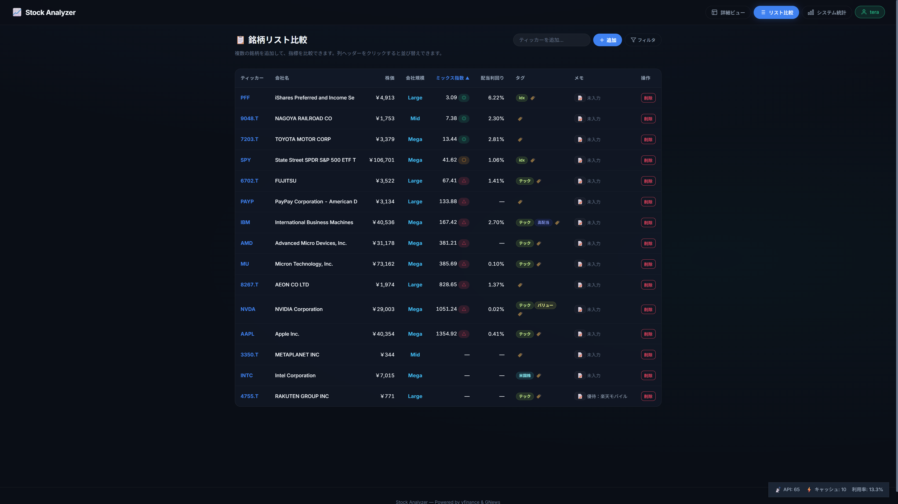
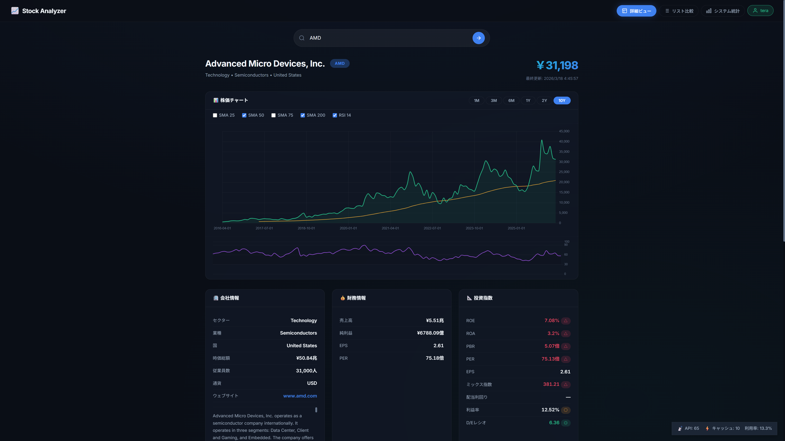
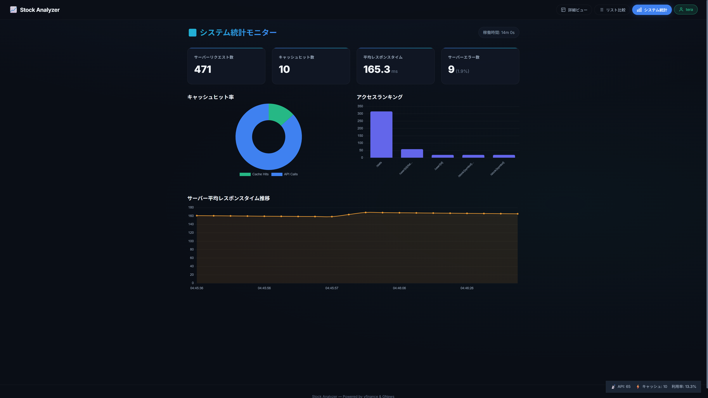

# Stock Data Platform

株式分析・為替確認・ウォッチリスト管理をまとめて扱える、FastAPI + シンプルなフロントエンドで構成された投資支援アプリです。

## このプロジェクトの目的

このアプリは、以下の目的で作成しています。

- ポートフォリオ管理＆ダッシュボード
- 投資戦略のバックテスト用ソフトの土台

## できること（概要）

- 株価・企業情報・財務情報・投資指標・ニュースの取得
- 「ＮＴＴ」「トヨタ」「apple」のような会社名や銘柄コードからティッカーを検索し、銘柄詳細・ウォッチリスト・単一銘柄のバックテストで選択できます。
- 為替レートの取得
- ユーザー登録・ログイン、パスワード変更、全端末のログアウト、アカウント削除
- 複数のウォッチリストを管理。株数と円の現金を任意で入力すると、円換算評価額と銘柄・地域・通貨・セクターの構成を確認できます。取得原価と損益の管理は証券会社の口座で行います。
- ウォッチリストはキャッシュを先に表示し、株価などを銘柄ごとにバックグラウンドで更新します。価格アラートもダッシュボードから管理できます。
- JSONバックアップとCSV出力。タグと銘柄メモはAPI、バックアップ、MCPから参照できます。
- Claudeの `get_watchlist` で株数・現金・構成比と集計対象から外れた銘柄を参照できます。
- API利用統計の確認
- Python完結型CLIによるバックテスト実行

旧ポートフォリオ画面はウォッチリストに統合しました。起動時のマイグレーション `0007` で旧保有銘柄をデフォルトリストに移し、取得単価・取得日・保有メモを破棄します。

## ドキュメント構成

- フロントエンド詳細: [docs/FRONTEND.md](docs/FRONTEND.md)
- バックエンドAPI詳細: [docs/API.md](docs/API.md)
- ポートフォリオ、ウォークフォワード、結果の保存・比較とCLIの使い方は [バックテストの使い方](docs/backtestCLI.md) を参照してください。
- LXC・systemd・Docker での運用: [docs/DEPLOY.md](docs/DEPLOY.md)
- Claude Desktop・Claude Code からアプリのデータを参照する手順は [docs/MCP.md](docs/MCP.md) を参照してください。

## セットアップ

パッケージ管理には [uv](https://docs.astral.sh/uv/) を使います。

```bash
# uv のインストール（未導入の場合）
# macOS / Linux
curl -LsSf https://astral.sh/uv/install.sh | sh
# Windows (PowerShell)
powershell -ExecutionPolicy ByPass -c "irm https://astral.sh/uv/install.ps1 | iex"

# 仮想環境 (.venv) の作成と依存パッケージ・開発ツールのインストール
uv sync

# サーバー起動（既定は 127.0.0.1:8000、1ワーカー）
uv run python -m app

# 自動リロードを使う場合
uv run uvicorn app.main:app --reload --reload-dir app --workers 1 --no-proxy-headers
```

`uv run` はプロジェクト直下の `.venv` を自動で使うため、仮想環境の有効化（activate）は不要です。
`uv sync` は pytest・ruff などの開発ツールもインストールします。
従来の `uv run uvicorn app.main:app --reload --reload-dir app` でも開発できます。上の例では転送ヘッダーの検証をアプリの `TRUSTED_PROXIES` に任せています。

```bash
uv run pytest
uv run ruff check
uv run basedpyright
# フロントエンド検証（Node.js 22、追加のnpm依存なし）
node --test "tests/frontend/**/*.test.mjs"
```

フロントエンドの `.js` は ES Modules です。Node.js 22.17 以降は構文を自動検出できるため、
`package.json` や追加ローダーなしで上記コマンドを実行できます。
テストのDOM shimはブラウザー向けの描画文字列を検証します。

コミット時に lint・型検査・依存関係の整合性チェックを実行するには、環境作成後に `uv run pre-commit install` を実行します。フックはローカルの開発ツールを使います。

pip を使う場合も `pip install -r requirements.txt` で導入できます。
`requirements.txt` は `uv.lock` から生成されるファイルです。依存関係は `pyproject.toml` で管理します。

設定は `.env.example` を参考に `.env` で指定します。フロントエンドはAPIと同一オリジンで配信されるため、`CORS_ORIGINS` は既定で空欄（CORSミドルウェアなし）です。
別オリジンのフロントエンドを使う場合だけ `CORS_ORIGINS=http://a.example, http://b.example` のように許可先を指定してください。JSON配列も使え、前後の空白と空要素は除去します。
認証はBearerヘッダーを使い、Cookie等のCORS資格情報は許可しません。許可メソッドはGET/POST/PUT/DELETE/OPTIONSで、Authorization、Content-Type、X-Request-IDを送信できます。`*` と資格情報の併用は拒否します。

ログイン・登録とデータ取得のレート制限は既定で有効です。`RATE_LIMIT_*` 設定と429応答の詳細は [APIガイド](docs/API.md) を参照してください。

## アクセス先

- アプリ: `http://localhost:8000/`
- ヘルスチェック: `http://localhost:8000/health`
- OpenAPI 定義: `http://localhost:8000/openapi.json`

## 画面イメージ

### 銘柄リスト比較


### 詳細ビュー


### システム統計


## データベースのマイグレーション

起動時に Alembic の `upgrade head` が自動実行されます。従来の `create_all` で作成したDBも移行できます。キャッシュの重複は最新の取得日時（同時刻なら最大ID）を残して整理し、ユーザーデータは保持します。

開発時の手動適用: `uv run alembic upgrade head`

モデル変更時のリビジョン作成: `uv run alembic revision --autogenerate -m "変更内容"`

`CACHE_RETENTION_DAYS`（既定30日）はキャッシュ保持期間の下限です。テーブルごとに、この設定と「そのテーブルで最長のTTL + `CACHE_STALE_MAX_DAYS`」の長い方を適用します。たとえば既定の財務キャッシュは97日間保持します。期限を過ぎたキャッシュは起動時と書き込み時（プロセス内で最大1時間に1回）に削除します。ユーザー関連テーブルは削除対象に含みません。

データ提供元からの取得に失敗した場合、TTLを過ぎてから `CACHE_STALE_MAX_DAYS`（既定7日、0で無効）以内の保存済みデータを `stale: true` と取得日時 `cached_at` 付きで返します。為替の最終取得レートはSQLiteに保存し、再起動後も参照できます。同時取得の共有はプロセス内に限られます。

`CACHE_WARM_ENABLED=true` で、全ユーザーのウォッチリストに登録された銘柄の株価とUSD/JPYをバックグラウンドで更新できます。既定は無効で、有効時は `CACHE_WARM_INTERVAL_MINUTES`（既定30分）ごとに最大 `CACHE_WARM_CONCURRENCY`（既定2件）を並行更新します。提供元のレート制限に達した場合は次の更新まで待機します。

銘柄検索のディレクトリには、個人利用向けに実行時に取得する JPX 上場銘柄一覧と Nasdaq Trader Symbol Directory を使います。銘柄一覧はリポジトリに同梱していません。`SYMBOL_DIRECTORY_ENABLED`（既定 `true`）の場合、起動時に未取得または `SYMBOL_DIRECTORY_MAX_AGE_DAYS`（既定7日）を過ぎた市場をバックグラウンドで更新します。手動更新と設定の詳細はデプロイガイドを参照してください。 [docs/DEPLOY.md](docs/DEPLOY.md)

ニュースは既定で過去30日間を検索します。`NEWS_PERIOD` で期間を変更でき、空欄にすると期間制限がなくなります。指定した期間に記事が見つからない場合は、期間を外して一度だけ検索し直します。公開日時はUTCで返し、旧形式のキャッシュも読み取り時に変換します。
